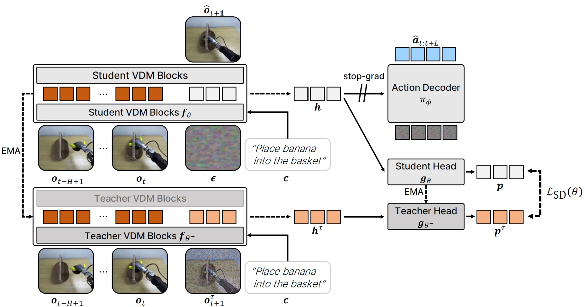

<h1 align="center">Self-Distilling Future Video Representations<br>for World Action Models</h1>

<div align="center">
  <a href="https://huiwon-jang.github.io/" target="_blank">Huiwon&nbsp;Jang</a><sup>1,2*</sup> &ensp; <b>&middot;</b> &ensp;
  <a href="https://suhyeok-jang.github.io/" target="_blank">Suhyeok&nbsp;Jang</a><sup>1,2*</sup> &ensp; <b>&middot;</b> &ensp;
  Hyeonmo&nbsp;Kang<sup>1</sup>
  <br>
  Seungku&nbsp;Kim<sup>1</sup> &ensp; <b>&middot;</b> &ensp;
  <a href="https://alinlab.kaist.ac.kr/shin.html" target="_blank">Jinwoo&nbsp;Shin</a><sup>1,2</sup> &ensp; <b>&middot;</b> &ensp;
  <a href="https://sihyun.me/" target="_blank">Sihyun&nbsp;Yu</a><sup>1</sup><br>
  <sup>1</sup> KAIST &emsp; <sup>2</sup> RLWRLD &emsp; <br>
  <sup>*</sup>Equal Contribution &emsp; <br>
</div>
<p align="center">
  <a href="https://arxiv.org/abs/2610.30320"></a>
  <a href="https://huiwon-jang.github.io/FRED/"></a>
  <a href="https://huggingface.co/FRED-AGI-LAB/models"></a>
</p>
<br>

<p align="center"></p>

**FRED** (Future REpresentation learning via self-Distillation with temporal context) trains World Action Models (WAMs)
to produce better *future video representations* from a single denoising step. The video model is conditioned on a short history of observations and the instruction, and its intermediate
representation of the future is trained by self-distillation: a momentum (EMA) copy of the video model that sees the
noisy ground-truth future is the teacher, on top of the video and action flow-matching losses.

## Installation

```bash
uv sync --python 3.10                      # torch 2.7.0, transformers 4.57.0, diffusers 0.37.1, deepspeed 0.19.7, flash-attn 2.7.4
VIRTUAL_ENV=.venv uv pip install -e . --no-deps
```

## Documentation (Per-benchmark Guides)

- RoboCasa kitchen: [docs/robocasa_kitchen.md](docs/robocasa_kitchen.md)
- GR-1 tabletop: [docs/gr1_tabletop.md](docs/gr1_tabletop.md)
- LIBERO: [docs/libero.md](docs/libero.md)
- DROID (5B and 14B, real robot): [docs/droid.md](docs/droid.md)
- OpenArm (data layout): [docs/openarm.md](docs/openarm.md)

## Results

Success rates of FRED on the simulation benchmarks (Wan2.2-TI2V-5B):

| Benchmark | Global batch | Iterations | Success rate (%) |
|---|---|---|---|
| RoboCasa Kitchen | 64 | 100K | 68.8 |
| RoboCasa Kitchen | 256 | 100K | 75.4 |
| GR-1 Tabletop | 64 | 100K | 54.8 |
| LIBERO | 64 | 100K | 98.2 |

## Checkpoints

| Model | Backbone | Training | HuggingFace |
|---|---|---|---|
| FRED-5B-DROID | Wan2.2-TI2V-5B | DROID, batch 128, 150K iterations | [FRED-AGI-LAB/fred-wan22-5b-droid](https://huggingface.co/FRED-AGI-LAB/fred-wan22-5b-droid) |
| FRED-14B-DROID | Wan2.1-I2V-14B | DROID, batch 128, 100K iterations | [FRED-AGI-LAB/fred-wan21-14b-droid](https://huggingface.co/FRED-AGI-LAB/fred-wan21-14b-droid) |
| FRED-5B-RoboCasa | Wan2.2-TI2V-5B | RoboCasa Kitchen, batch 256, 100K iterations | [FRED-AGI-LAB/fred-wan22-5b-robocasa-kitchen](https://huggingface.co/FRED-AGI-LAB/fred-wan22-5b-robocasa-kitchen) |

## Training

1. Precompute the umT5 text embeddings of the dataset (for efficiency the text encoder is not loaded during training):

```bash
.venv/bin/python scripts/precompute_text_embeds.py --data-root <lerobot dir> [--data-root ...] \
    --output-path ~/.cache/wam/<name>_wan22_umt5.pt --include-empty-prompt
```

- `--data-root`: dataset directory, repeatable; the cache holds every task string of all of them
- `--include-empty-prompt`: also embed the empty string, which caption dropout (`TEXT_DROPOUT`) samples
- `--append --output-path <cache.pt> --prompts '...'`: add prompts to an existing cache

2. Train, e.g. RoboCasa kitchen on 4 GPUs:

```bash
NUM_GPUS=4 GLOBAL_BATCH_SIZE=64 MAX_STEPS=100000 \
DATASETS=<dataset dir> TEXT_EMBED_CACHE=~/.cache/wam/robocasa300_wan22_umt5.pt \
bash run_scripts/train/train_fred_wan22_5b_robocasa_kitchen.sh
```

| Script | Dataset | Backbone |
|---|---|---|
| `train_fred_wan22_5b_robocasa_kitchen.sh` | RoboCasa kitchen | Wan2.2-TI2V-5B |
| `train_fred_wan22_5b_gr1.sh` | GR-1 tabletop | Wan2.2-TI2V-5B |
| `train_fred_wan22_5b_libero.sh` | LIBERO | Wan2.2-TI2V-5B |
| `train_fred_wan22_5b_droid.sh` | DROID | Wan2.2-TI2V-5B |
| `train_fred_wan21_14b_droid.sh` | DROID | Wan2.1-I2V-14B |
| `train_fred_wan22_5b_openarm_robot.sh` | OpenArm, robot data | Wan2.2-TI2V-5B |
| `train_fred_wan22_5b_openarm_robot_human.sh` | OpenArm, robot + human co-training | Wan2.2-TI2V-5B |

Options (environment variables of `run_scripts/train/train_fred.sh`):

- `NUM_GPUS`, `GLOBAL_BATCH_SIZE`, `GRAD_ACCUM`, `MAX_STEPS`, `WARMUP_STEPS`, `LR`, `MIN_LR_RATIO`: schedule
- `BACKBONE_TYPE=wan22_5b | wan21_14b`: video model
- `NUM_FRAMES_IN` / `NUM_FRAMES_OUT`: history + current / total clip frames
- `GC=1`: gradient checkpointing on the video DiT
- `RESUME=auto | 0 | 1`: continue from the newest checkpoint of the run; `BASE_MODEL_PATH=<checkpoint dir | HF repo>`: warm start
- `EXTRA_ARGS="--data.seed 1"`: any other flag of `fred/experiment/launch_train.py` (`--help`)
- `DRY_RUN=1`: print the command only

## Evaluation

1. Set up the simulator (once per benchmark; each gets its own virtual environment):

```bash
bash fred/eval/sim/robocasa/setup_robocasa.sh          # RoboCasa kitchen
bash fred/eval/sim/gr1_tabletop/setup_gr1_tabletop.sh  # GR-1 tabletop
bash fred/eval/sim/libero/setup_libero.sh              # LIBERO
```

2. Evaluate a checkpoint on every task of a benchmark:

```bash
TEXT_EMBED_CACHE=<cache.pt> \
bash run_scripts/eval/eval_fred.sh <benchmark> <checkpoint dir> <output dir>
```

- `<benchmark>`: `robocasa_kitchen` | `gr1_tabletop` | `libero`
- `TEXT_EMBED_CACHE`: the umT5 cache of the benchmark's dataset (from the training step 1)
- `TASKS="<task> ..."`: a subset of `run_scripts/eval/tasks/<benchmark>.txt`
- `N_EPISODES`, `N_ENVS`, `PORT`: episodes per task, parallel envs, policy-server port
- `<output dir>/results.txt`: success rate per task and the mean; re-running on the same directory resumes

The script starts a policy server (`fred/eval/serve_policy.py`) that serves the checkpoint and a simulator client
(`fred/eval/rollout_policy.py`) that rolls the tasks out against it. A real robot uses the same policy server; see
`docs/droid.md`.

## Citation

```bibtex
@article{fred2026,
  title   = {Self-Distilling Future Video Representations for World Action Models},
  author  = {Jang, Huiwon and Jang, Suhyeok and Kang, Hyeonmo and Kim, Seungku and Shin, Jinwoo and Yu, Sihyun},
  journal = {arXiv preprint arXiv:2610.30320},
  year    = {2026}
}
```

> [!NOTE]
> While we have made efforts to ensure the correctness of the released code, unintentional errors may have been
> introduced during code cleanup and preparation. If you encounter any issues reproducing the results reported in our
> paper, please feel free to reach out or open an issue. We will continue to verify and improve the codebase.

## License

This project is released under the [Apache-2.0 License](LICENSE). See [NOTICE](NOTICE) for third-party attributions.

## Acknowledgement

This code is mainly built upon [Isaac-GR00T](https://github.com/NVIDIA/Isaac-GR00T), [Wan2.2](https://github.com/Wan-Video/Wan2.2), [diffusers](https://github.com/huggingface/diffusers), [DINO](https://github.com/facebookresearch/dino), and [iBOT](https://github.com/bytedance/ibot) repositories.
